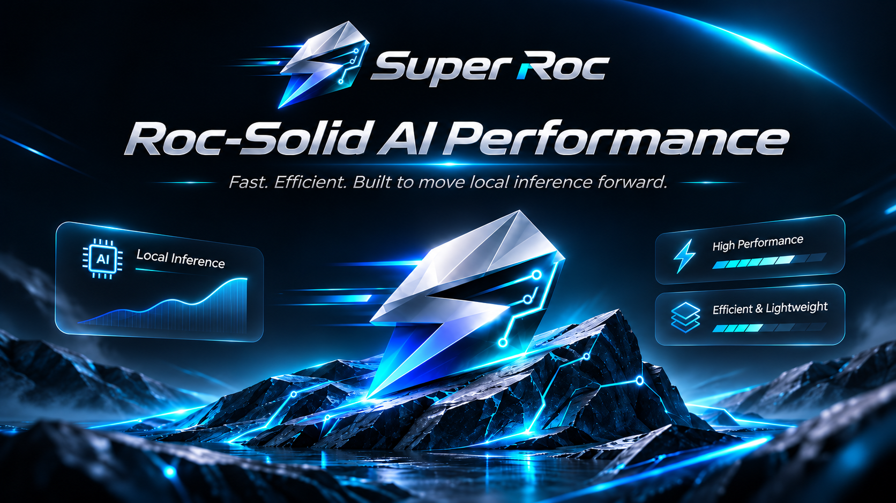
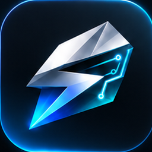

<h1 align="center">
  
</h1>

<p align="center">
  <a href="LICENSE"></a>
  <a href="https://github.com/kingjones30/superroc/releases/latest"></a>
  
  
  <a href="https://github.com/kingjones30/superroc/actions/workflows/ci.yml"></a>
</p>

<p align="center">
  <a href="#top-performers"><b>Top performers</b></a> &nbsp;·&nbsp;
  <a href="#models"><b>Models</b></a> &nbsp;·&nbsp;
  <a href="#build-from-source"><b>Build</b></a> &nbsp;·&nbsp;
  <a href="#run"><b>Run</b></a> &nbsp;·&nbsp;
  <a href="#anthropic-api-and-claude-code"><b>API</b></a> &nbsp;·&nbsp;
  <a href="#lineage-and-credits"><b>Lineage</b></a>
</p>

Super Roc is an LLM inference engine for AMD Strix Halo: Ryzen AI Max+ 395 systems with the Radeon 8060S GPU (`gfx1151`)
and up to 128 GB of unified memory. It serves GGUF models, including 4-bit ROCmFP4 builds, through an OpenAI- and
Anthropic-compatible server with MTP and DSpark drafting and a prompt cache that can resume from any earlier
conversation state.

Super Roc is its own engine project. Issues, pull requests and forks are welcome.

## What Super Roc adds

- **ROCmFP4 / ROCmFPX tensor types** (GGUF types 100 and above) in the loader, the kernels and the serving path, including
  spill-free dense prefill and decode kernels for the 4-bit types.
- **`superroc-quant`**, a standalone GGUF quantizer for the ROC recipes (STRIX, STRIX_LEAN, LEAN, COHERENT, FAST and the G4
  variants) with protect rules, a tensor census, manifests and streaming output. For the ROC recipes its output is byte
  for byte the same as the ROCmFPX `llama-quantize`. See [docs/superroc-quant.md](docs/superroc-quant.md).
- **More model families**: `qwen35` / `qwen35moe` ROC builds (Qwen3.8, KAT-Coder, Ornith, MiniCPM-V, OxCoder, Agnes,
  Nex, BTL-4, MiMo), `bailingmoe3` (Ling-3.0-flash and Ling-3.0-flash-VL), `lfm2` / `lfm2moe` (LFM2.5), `flint`
  (Flint 40B-A2.5B: sliding-window and position-free attention layers with attention sinks), `llama`
  (Nanbeige4.3-33B-Base, serve-only: [limits](docs/models/llama/README.md)) and Muse Glimmer.
- **Drafting**: embedded and sidecar MTP heads with a per-request draft depth and exact verification, the DSpark
  drafter, and prompt-cache snapshots that keep working while a drafter is on.
- **Stock MoE GGUFs**: `qwen35moe` files with Q4_K, Q5_K, Q6_K or Q8_0 routed experts, such as common Q4_K_XL
  builds and ROCmFPX Q8 files, run on the mixture-of-experts kernels with the expert choice kept on the GPU.
- **Speed settings**: a 4-bit prefill route for dense ROCmFP4 files, a tensor overlay and a routed-expert count for
  mixture-of-experts files, and prompt-lookup drafting ([options](docs/CLI.md#llm-or-text)).
- **Tool calls** in each model's native format (Qwen, GLM-style, Ling, Flint), constrained by a grammar built from the
  request's tools where the format allows it.
- **Hardening**: HTTP header and body read deadlines and size caps, constant-time API key comparison, checked HIP kernel
  launches, and validation in the GGUF reader, configuration and weight binders.

## Top performers

Models where Super Roc measured fastest among the engines we ran on the same machine. Measured with `lemonade bench`, the public
benchmark harness of AMD's [Lemonade](https://github.com/lemonade-sdk/lemonade), which drives every engine through Lemonade with
the same requests (greedy decoding; a fresh model load before each run, mean of two runs) on a Ryzen AI Max+ 395 with
128 GB. *4K* and *32K* are the harness's long-context scenarios (about 3,250 and 24,800 prompt tokens). Each engine runs with
the speculative decoding it turns on by default for the model.

Each cell reads *Super Roc* vs *the fastest other engine*, in tokens per second; only the tests where Super Roc
measured fastest are listed.

| Model | Category | Prompt, 4K | Prompt, 32K | Generation, 4K | Generation, 32K |
|---|---|---:|---:|---:|---:|
| Qwen3.8-27B ¹ | 27B dense | **664.9** vs 377.6 | **593.9** vs 329.9 | **33.8** vs 26.8 | **43.4** vs 29.4 ² |
| Qwen3.8-Flash-Next ³ | 177B MoE | | | **61.9** vs 40.3 | **58.1** vs 39.2 |

¹ [Unsloth UD-Q4_K_XL](https://huggingface.co/unsloth/Qwen3.8-27B-GGUF), the same file for every engine.

² With the DFlash2 drafter and prompt lookup; with the defaults, 30.3 vs 29.4.

³ Super Roc on the [ROCmFP4 STRIX_LEAN file](https://huggingface.co/kingjones777/Qwen3.8-Flash-Next-ROCmFP4-STRIX_LEAN-GGUF)
with 7 routed experts and its shared MTP head; the other engines on their own files for this model.

Qwen3.8-27B was measured with the 0.20.0 release on 2026-11-23, Qwen3.8-Flash-Next with the build of 2026-11-20 that
became 0.20.0. Every scenario and setup of both runs, including the tests where another engine is faster, is in
[docs/BENCHMARKS.md](docs/BENCHMARKS.md#results-through-lemonades-benchmark-strix-halo).

## Models

Measured with this repository's code on Ryzen AI Max+ 395 systems (128 GB, ROCm 7.2.4 or 7.13.0, named in each card):
one request at a time, temperature 0, cold prompt cache, drafter as in the card's serve command. *Prompt* is prompt
processing on a document question of 1,517 to 1,641 tokens (depending on the tokenizer); *Generation* is the speed of the answer to that prompt (up to
256 tokens); *Code* is the mean generation speed over six coding prompts (up to 256 tokens each). Each card has the
exact files, the serve command, more measurements, quality numbers where they exist, and known limits.

| Model | Size | File (Hugging Face) | Drafter | Prompt tok/s | Generation tok/s | Code tok/s | Card |
|---|---|---|---|---:|---:|---:|---|
| KAT-Coder-V2.5-Dev Abliterated | 35B-A3B MoE | [STRIX_LEAN, MTP block Q8_0](https://huggingface.co/kingjones777/KAT-Coder-V2.5-Dev-Abliterated-MTP-ROCmFP4-GGUF) | embedded MTP | 1,713.1 | 84.7 | 107.3 | [card](docs/models/kat-coder-v2.5/README.md) |
| Ornith-1.5-35B-A3B | 35B-A3B MoE | [LEAN v1](https://huggingface.co/kingjones777/Ornith-1.5-35B-A3B-ROCmFP4-STRIX-LEAN-GGUF) | embedded MTP | 1,773.7 | 74.6 | 96.4 | [card](docs/models/ornith-1.5-35b/README.md) |
| MiniCPM-V-4.7-35B-A3B | 35B-A3B MoE, vision | [LEAN, Q6_K trunk](https://huggingface.co/kingjones777/MiniCPM-V-4.7-35B-A3B-ROCmFP4-GGUF) | none | 1,876.3 | 65.2 | 65.7 | [card](docs/models/minicpm-v-4.7-35b-a3b/README.md) |
| Agents-A1 Abliterated | 35B-A3B MoE | [STRIX_LEAN](https://huggingface.co/kingjones777/Agents-A1-Abliterated-MTP-ROCmFP4-GGUF) | none | 1,767.7 | 77.0 | 78.0 | [card](docs/models/agents-a1/README.md) |
| BTL-4 | MoE (qwen35moe) | [STRIX_LEAN](https://huggingface.co/kingjones777/BTL-4-ROCmFP4-STRIX_LEAN-GGUF) | none | 1,771.0 | 80.6 | 81.4 | [card](docs/models/btl-4/README.md) |
| Nex-N2.5-mini | MoE (qwen35moe) | [STRIX_LEAN](https://huggingface.co/kingjones777/Nex-N2.5-mini-ROCmFP4-GGUF) | none | 1,753.1 | 77.1 | 78.0 | [card](docs/models/nex-n2.5-mini/README.md) |
| Qwen3.8-Flash-Next Uncensored | 177B MoE | [STRIX_LEAN imatrix, hc tensors Q8_0](https://huggingface.co/kingjones777/Qwen3.8-Flash-Next-Uncensored-ROCmFP4-STRIX_LEAN-imatrix-GGUF) | MTP head Q8_0 | 1,261.2 | 56.1 | 56.8 | [card](docs/models/qwen3.8-flash-next/SUPERROC.md) |
| Qwen3.8-Flash-Next | 177B MoE | [Unsloth UD-Q4_K_XL](https://huggingface.co/unsloth/Qwen3.8-Flash-Next-GGUF) | shared MTP Q8_0 | 1,369.1 | 47.6 | 59.9 | [card](docs/models/qwen3.8-flash-next/SUPERROC.md) |
| Qwen3.8-27B | 27B dense | [STRIX imatrix, head/embedding Q6_K](https://huggingface.co/kingjones777/Qwen3.8-27B-ROCmFP4-STRIX-MTP-GGUF) | DFlash2 | 513.6 | 27.6 | 50.6 | [card](docs/models/qwen3.8-27b/SUPERROC.md) |
| Qwen3.8-27B | 27B dense | [Unsloth UD-Q4_K_XL](https://huggingface.co/unsloth/Qwen3.8-27B-GGUF) | DFlash2 | 545.6 | 27.2 | 44.3 | [card](docs/models/qwen3.8-27b/SUPERROC.md) |
| Qwen3.8-27B Uncensored | 27B dense | [STRIX_LEAN](https://huggingface.co/kingjones777/Qwen3.8-27B-Uncensored-ROCmFP4-STRIX-MTP-GGUF) | MTP Q4_0 | 509.6 | 26.3 | 43.9 | [card](docs/models/qwen3.8-27b-uncensored/README.md) |
| Qwen3.8-27B Fable Cold Fusion Heretic | 27B dense, vision | [FAST imatrix](https://huggingface.co/kingjones777/Qwen3.8-27B-TURBO-Fable-Cold-Fusion-Heretic-ROCmFP4-FAST-imatrix-GGUF) | MTP Q4_0 | 498.8 | 29.1 | 41.7 | [card](docs/models/qwen3.8-27b-fable-heretic/README.md) |
| Agnes-3.0-Flash-Preview | 33B dense | [STRIX_LEAN](https://huggingface.co/kingjones777/Agnes-3.0-Flash-Preview-MTP-ROCmFP4-GGUF) | MTP sidecar Q8_0 | 423.0 | 21.5 | 29.2 | [card](docs/models/agnes-3.0-flash/README.md) |
| OxCoder-9B | 9B dense | [STRIX_LEAN](https://huggingface.co/kingjones777/OxCoder-9B-MTP-ROCmFP4-GGUF) | MTP (own block) | 1,437.7 | 51.8 | 76.4 | [card](docs/models/oxcoder-9b/README.md) |
| Ornith-1.5-9B | 9B dense | [STRIX_LEAN](https://huggingface.co/kingjones777/Ornith-1.5-9B-ROCmFP4-STRIX-LEAN-GGUF) | none | 1,703.1 | 42.3 | 42.7 | [card](docs/models/ornith-1.5-9b/README.md) |
| MiMo-V2.6-Distill-Qwen-9B | 9B dense | [STRIX_LEAN](https://huggingface.co/kingjones777/MiMo-V2.6-Distill-Qwen-9B-ROCmFP4-GGUF) | none | 1,625.4 | 42.2 | 42.5 | [card](docs/models/mimo-v2.6-9b/README.md) |
| Ling-3.0-flash-VL | 124B-A5.5B MoE, vision | [STRIX_LEAN](https://huggingface.co/kingjones777/Ling-3.0-flash-VL-MTP-ROCmFP4-GGUF) | none | 569.2 | 38.4 | 37.4 | [card](docs/models/ling-3.0-flash-vl/README.md) |
| LFM2.5-24B-A2B | 24B-A2B MoE | [LEAN (from the QAD 4-bit file)](https://huggingface.co/kingjones777/LFM2.5-24B-A2B-ROCmFP4-GGUF) | none | 2,459.2 | 97.8 | 101.8 | [card](docs/models/lfm2.5/README.md) |
| LFM2.5-8B-A1B | 8B-A1B MoE | [LEAN](https://huggingface.co/kingjones777/LFM2.5-8B-A1B-ROCmFP4-LEAN-GGUF) | none | 4,037.2 | 153.4 | 158.5 | [card](docs/models/lfm2.5/README.md) |
| LFM2.5-2.6B | 2.6B dense | [LEAN](https://huggingface.co/kingjones777/LFM2.5-2.6B-ROCmFP4-LEAN-GGUF) | none | 3,317.9 | 104.9 | 108.6 | [card](docs/models/lfm2.5/README.md) |
| LFM2.5-1.2B-Instruct | 1.2B dense | [LEAN](https://huggingface.co/kingjones777/LFM2.5-1.2B-Instruct-ROCmFP4-GGUF) | none | 6,992.6 | 210.7 | 223.3 | [card](docs/models/lfm2.5/README.md) |
| Flint 40B-A2.5B | 40B-A2.5B MoE | [COHERENT-PAS](https://huggingface.co/kingjones777/Flint-40B-A2.5B-ROCmFP4-GGUF) | none | 1,119 ¹ | 58.9 ¹ | — | [card](docs/models/flint/README.md) |

¹ Flint was measured with its own method: a 512-token prompt and 128 generated tokens. Its card has the 4K and 16K numbers.

The table was measured on the 2026-10-25 build. Speed settings new in this release, each measured on the card's file
with the setting off and on in alternating runs on one build (method and serve command in each card):

| Model | Setting | Prompt tok/s | Generation tok/s | Perplexity |
|---|---|---:|---:|---:|
| Qwen3.8-27B, ROCmFP4 STRIX imatrix | 4-bit prefill route | 586 → 782 (1K), 577 → 754 (8K) | 30.2 → 31.4 | 4.641 → 4.645 |
| Qwen3.8-Flash-Next Uncensored | tensor overlay, 6 of 10 experts | 1,393 → 1,523 | 52.4 → 58.2 | 5.128 → 5.046 |
| KAT-Coder-V2.5-Dev Abliterated | 6 of 8 experts | 2,101 → 2,315 | 98.5 → 105.4 | 6.402 → 6.512 |

Also supported, with the upstream project's guides (its measurements, not re-measured here):
[DeepSeek V4 Flash](docs/models/deepseek-v4-flash/README.md), [Qwen3-ASR 1.7B](docs/models/qwen3-asr/README.md),
[Qwen3-TTS 1.7B](docs/models/qwen3-tts/README.md), [Qwen-Image-2.1](docs/models/qwen-image-2.1/README.md) and
[MiniMax H3](docs/models/minimax-h3/README.md). The upstream usage guides for
[Qwen3.8 27B](docs/models/qwen3.8-27b/README.md) and [Qwen3.8 Flash-Next](docs/models/qwen3.8-flash-next/README.md)
are kept next to the Super Roc cards for those models.

## Build from source

Linux x86-64 on AMD Strix Halo (`gfx1151`) is the supported target.

### With Nix

```sh
nix build
./result/bin/superroc diagnose
./result/bin/superroc serve llm --model /path/to/model.gguf
```

### Without Nix

Install a C++20 compiler, CMake 3.21+, Ninja, pkg-config and the ROCm HIP development libraries (ROCm normally installs
under `/opt/rocm`), then:

```sh
sudo apt install build-essential cmake ninja-build pkg-config \
  libicu-dev libcurl4-openssl-dev libssl-dev libpng-dev libjpeg-dev libwebp-dev ffmpeg

# ROCm libraries, named as AMD's repository ships them.
sudo apt install hipblas-dev hipblaslt-dev rocblas-dev \
  hipcub-dev rocprim-dev rocwmma-dev

cmake --preset release -DCMAKE_INSTALL_PREFIX="$HOME/.local"
cmake --build --preset release --parallel 4
./build/release/superroc diagnose
```

`cmake --install build/release` installs Super Roc, its runtime data and the license notices.

## Run

Serve a model (here KAT-Coder-V2.5-Dev Abliterated with its embedded MTP drafter, see its card):

```sh
./build/release/superroc serve --host 127.0.0.1 --port 8080 llm \
  --model /path/to/KAT-Coder-V2.5-Dev-Abliterated-MTPq8-Q4_0_ROCMFP4_STRIX_LEAN.gguf \
  --served-model-name kat-coder --context 131072 --think off --speculative mtp -d 3 --min-draft-tokens 1
```

Then ask it something through the OpenAI-compatible API:

```sh
curl http://localhost:8080/v1/chat/completions \
  -H "Content-Type: application/json" \
  -d '{"model": "kat-coder", "messages": [{"role": "user", "content": "Write a Python function that reverses a list."}]}'
```

### Recipes

A tuned setup can travel with the model file as `superroc-recipe.json`: engine variables, sidecar files (such as an int4
prefill route or a tensor overlay) and tuning flags. Put the recipe and its sidecars next to the model and start with
`--recipe auto`; flags on the command line still take precedence:

```sh
./build/release/superroc serve --host 127.0.0.1 --port 8080 llm \
  --model /path/to/Qwen3.8-27B-UD-Q4_K_XL.gguf --dflash-model /path/to/Qwen3.8-27B-DFlash2-Q4_K_M.gguf \
  --speculative dflash2 --recipe auto
```

The recipe for that file is on Hugging Face at
[kingjones777/Qwen3.8-27B-SuperROC-Recipe](https://huggingface.co/kingjones777/Qwen3.8-27B-SuperROC-Recipe). The format
and its rules are in [docs/recipes.md](docs/recipes.md); measured results are in [docs/BENCHMARKS.md](docs/BENCHMARKS.md).

### Anthropic API and Claude Code

The same server speaks the Anthropic Messages API:

```sh
curl http://localhost:8080/v1/messages \
  -H "Content-Type: application/json" \
  -H "anthropic-version: 2023-06-01" \
  -H "x-api-key: none" \
  -d '{"model": "kat-coder", "max_tokens": 64, "messages": [{"role": "user", "content": "Write a Python function that reverses a list."}]}'
```

It supports streaming SSE, system prompts, tools with `tool_result` round trips, thinking blocks, `count_tokens`,
and prompt-cache usage fields. The request and response shapes are in [docs/SERVER.md](docs/SERVER.md#responses-api-subset).

Claude Code works against the server with these variables:

```sh
export ANTHROPIC_BASE_URL=http://localhost:8080
export ANTHROPIC_AUTH_TOKEN=none
export ANTHROPIC_MODEL=kat-coder
export ANTHROPIC_SMALL_FAST_MODEL=kat-coder
claude
```

`ANTHROPIC_MODEL` is the name the server was started with (`--served-model-name`).

For Open WebUI, VS Code, the OpenAI SDK and Responses-API clients, set the API base URL to `http://localhost:8080/v1`.
Anthropic SDK clients and Claude Code use `http://localhost:8080` as the base URL.
Chat Completions and Responses support text, images, function tools, structured output and streaming. The server uses
the model's native context by default; `--context N` sets the context per session and `--max-tokens N` a default
response limit that clients can override (reasoning tokens count toward it). The full API contract is in
[docs/SERVER.md](docs/SERVER.md) and the command line in [docs/CLI.md](docs/CLI.md).

### Lemonade

Super Roc runs inside a stock [Lemonade](https://github.com/lemonade-sdk/lemonade) install today: point
Lemonade's llama.cpp ROCm slot at the Super Roc launcher and add the Super Roc model list.

```sh
tools/lemonade/install.sh --superroc ./build/release/superroc --prefix /opt/superroc
lemonade config set llamacpp.rocm_bin=/opt/superroc/lemonade
```

Models that Super Roc does not run go to the stock llama-server unchanged. Setup, the model list and
troubleshooting: [docs/LEMONADE.md](docs/LEMONADE.md).

## Known gaps

- Muse Glimmer loads, but its DFlash drafter does not yet, and without it Super Roc generates more slowly than
  llama.cpp (ROCmFPX build) on that model.
- Several GPU tests and tools read a model file; they take its path from an environment variable and fail without it.

## Lineage and credits

Super Roc began as a fork of an MIT-licensed ROCm inference engine. The code is released under the MIT License in
[LICENSE](LICENSE). [NOTICE](NOTICE) names the upstream project; it and
[THIRD_PARTY_NOTICES.md](THIRD_PARTY_NOTICES.md) list the code that came from that project, from llama.cpp / ggml and
from other projects, with their licenses. Model weights are not included; each Hugging Face card states
the license of its weights.

Thanks to the ROCmFPX team, Carlo Pasquale ([@charlie12345](https://github.com/charlie12345)) and the
[ROCmFPX](https://github.com/charlie12345/ROCmFPX) contributors, for the ROCm-FP4 formats and the llama.cpp work they
started from, and to Donato Capitella ([@kyuz0](https://github.com/kyuz0)) for the ROCmFPX builds in his Strix Halo
toolboxes.

## Feedback

Open an issue with the hardware (CPU/GPU, memory, ROCm version), the model file, the exact command and the server log.
Measurements on other Strix Halo systems, new model families and kernel improvements are welcome as pull requests.

---

<p align="center">
  <br>
  <sub><b>Super Roc</b> · MIT License · the executable is <code>superroc</code></sub>
</p>
